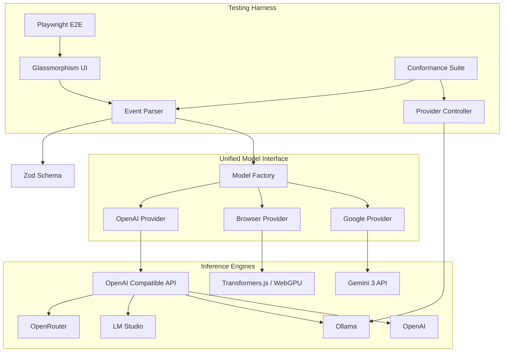

# Development Notes: System Architecture & Testing Harness

This document outlines the overhauled architecture of the GCal Quick Add application and the comprehensive testing suite developed to ensure model conformance and UI stability.

## System Architecture

The application follows a provider-based factory pattern to abstract the complexities of different LLM inference environments. The architecture has been simplified into three core pillars.

### Architecture Diagram



### Key Components

1.  **Unified Model Interface (`src/llm/interfaces.js`)**: A base class that enforces a consistent contract (`initialize`, `generate`, `generateStructured`) across all models.
2.  **Model Factory (`src/llm/factory.js`)**: Dynamically instantiates the correct provider based on the user's selected "Serving Pattern" (Cloud, Browser, or Device).
3.  **Structured Output (`src/llm/schema.js`)**: Utilizes **Zod** to define the expected calendar event structure. This ensures that regardless of the model used, the output is deterministic and valid JSON.
4.  **Providers**:
    *   **Google Provider**: High-intelligence inference via the Gemini 3 family.
    *   **Browser Provider**: Privacy-first inference using `transformers.js` running directly in the browser.
    *   **OpenAI Provider**: A generic, configurable provider that supports any OpenAI-compatible endpoint (OpenAI, OpenRouter, Ollama, LM Studio) by simply adjusting the `baseURL`.

---

## Testing Harness

The testing suite verifies the "intelligence" of the models alongside the stability of the UI.

### 1. Unit Tests (`tests/unit/`)
Focuses on the deterministic logic of the `EventParser`, specifically the generation of Google Calendar URLs and date formatting.

### 2. Conformance Suite (`tests/conformance/`)
This is the core "intelligence" check. It feeds a **Golden Dataset** of challenging natural language prompts to live LLM engines.
*   **Provider Controller**: A utility that manages the lifecycle of local servers (e.g., starting/stopping `ollama`).
*   **Golden Dataset**: Test cases covering complex recurrences, relative dates, and noisy human input.

### 3. Model Benchmark (`npm run bench`)
Transform the conformance suite into a scoring system. It runs enabled models against the Golden Dataset and calculates:
*   **Accuracy Score (%)**: How many cases matched the expected schema and logic.
*   **Latency (ms)**: Performance tracking for local vs. cloud inference.
*   **Detailed JSON Reports**: Exported to `tests/conformance/results/` for side-by-side comparison.

## Developer Workflow

### Running Tests & Benchmarks
```bash
# Run unit and conformance tests (Pass/Fail)
npm run test

# Run E2E UI tests
npm run test:e2e

# Run Model Intelligence Benchmark (Scoring)
npm run bench

# Run local Ollama benchmark (requires Ollama installed)
RUN_OLLAMA=true npm run bench
```

### Build Optimization
The project uses **Manual Chunking** in Vite to separate the heavy `transformers.js` weights from the main UI bundle, ensuring fast initial load times.