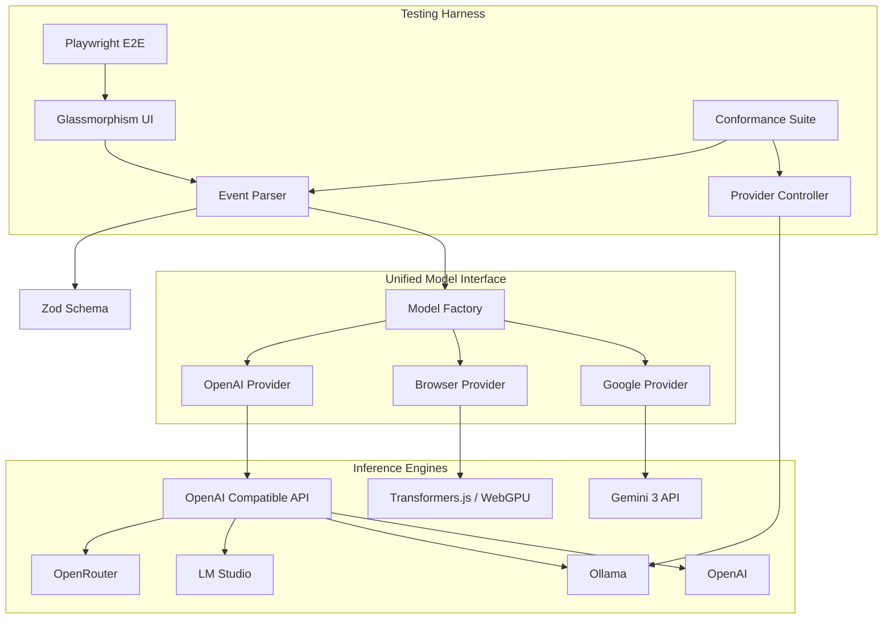

# System Architecture

The application follows a provider-based factory pattern to abstract the complexities of different LLM inference environments.

## Architecture Diagram

## Key Components

1. **Unified Model Interface (`src/llm/interfaces.js`)**: A base class that enforces a consistent contract (`initialize`, `generate`, `generateStructured`) across all models.

2. **Model Factory (`src/llm/factory.js`)**: Dynamically instantiates the correct provider based on the user's selected serving strategy (Cloud, Browser, or Local).

3. **Structured Output (`src/llm/schema.js`)**: Utilizes **Zod** to define the expected calendar event structure. This ensures that regardless of the model used, the output is deterministic and valid JSON.

## Providers

| Provider | Serving Strategy | Description |
|----------|------------------|-------------|
| **Google Provider** | Cloud | High-intelligence inference via the Gemini 3 family |
| **Browser Provider** | Browser | Privacy-first inference using `transformers.js` running directly in the browser |
| **OpenAI Provider** | Cloud / Local | Generic provider supporting any OpenAI-compatible endpoint (OpenAI, OpenRouter, Ollama, LM Studio) |

## Build Optimization

The project uses **Manual Chunking** in Vite to separate the heavy `transformers.js` weights from the main UI bundle, ensuring fast initial load times.
